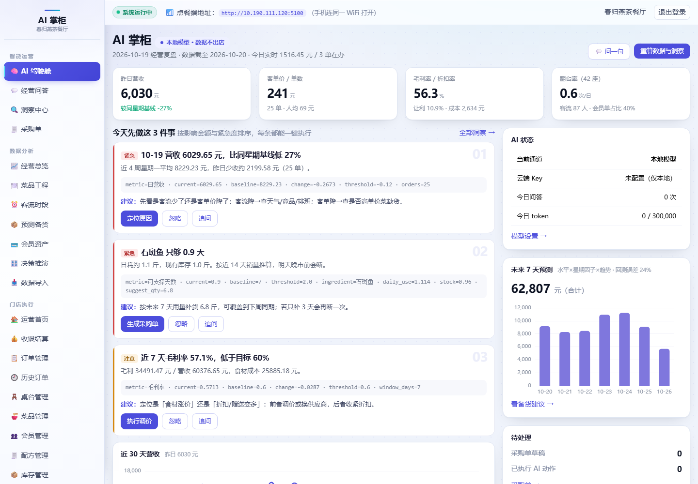

# AI 掌柜 · 中小餐饮经营 Agent

> 2026 武汉 1024 人工智能创新应用黑客松 · **产业应用赛道**

**不只告诉你哪里亏，还替你把账算平、把货备好、把菜单改对。**

代码仓库：<https://github.com/wsj20011001/ai-zhanggui>



中小餐饮老板每天面对的是同一组问题：今天到底赚没赚、明天该买多少、哪道菜在赔钱。
市面上的工具给他更多报表，AI 掌柜给他**三个动作**——而且每个动作都能一键执行、可撤销、可追溯。

---

## 0. 按评审维度看这个项目

> 评委可直接对照本节核材料，每一条都能在仓库里找到对应文件和可复现的命令。

### 技术先进性与问题解决能力（30）

| 评审要点 | 我们的证据 |
|---|---|
| 超越简单 API 调用 | 模型只做意图与措辞，**数字由 SQL 与确定性算法产出**；模型只能看见 8 个只读视图，SQL 需过五道闸 → `ai/sandbox.py`、`ai/nl2sql.py` |
| 自研核心算法 | 三层分解预测（水平×星期因子×趋势）+ 滚动回测；营收变化拆解为客流/客单价；6 类规则洞察检测器 → `analytics/metrics.py`、`analytics/insights.py` |
| 技术突破性 | **结论级数字校验**：模型把"9 种"说成"6 种"、把"2.8 斤"写成"3.2 kg"时会被服务端判定为编造并自动重写 → `ai/nl2sql.py::_check_insight`，详见 [docs/技术说明.md](docs/技术说明.md) |
| 问题针对性 | 三个问题（赚没赚 / 买多少 / 哪道菜赔钱）直接对应三个页面，不做泛化的"AI 助手" |

### 方案成熟度与工程质量（35）

| 评审要点 | 我们的证据 |
|---|---|
| 可运行性 | `pip install -r requirements.txt` + `python seed_demo.py` + `python app.py` 三条命令跑起来；无 Python 环境双击 `start.bat` |
| 功能完整性 | 点单 / 收银 / 会员 / BOM / 库存 / 预订 全链路 + 8 个决策页面，**22 个页面全量冒烟通过** |
| 代码质量 | 分层清晰（`analytics` 指标层 / `ai` 引擎层 / `blueprints` 接口层）；README + [技术说明](docs/技术说明.md) + 8 次语义化提交 + MIT [LICENSE](LICENSE) |
| 系统健壮性 | 三层降级（本地→云端→规则）、SQL 超时中断、动作幂等、异常兜底；演示断网仍可用 |
| 数据安全 | Key 存独立文件不入库、`.gitignore` 排除 `*.db`；模型只能读聚合视图，看不到会员手机号；SQL 只读连接 |
| 测试覆盖 | 6 个套件一键运行 `python run_tests.py`：页面 22/22、沙箱越界 8/8、口径一致 5 处、CSV 导入、Mock 模型链路、单元测试 50/50；另有 NL2SQL 评测集 12 题（`tests/eval_nl2sql.py`） |
| 错误处理 | 400/404/413/500 统一错误页，给一句人话 + 出口链接；表单校验逐字段提示；模型不可用时明确告知降级原因 |

### 落地可行性与可推广性（20）

| 评审要点 | 我们的证据 |
|---|---|
| 部署与成本 | 单机 Flask + SQLite，**无 GPU、无外网也能跑**；无 Python 环境可打包 EXE；详见 [docs/部署说明.md](docs/部署说明.md) |
| 接入路径 | 已有 `CSV 导入`：收银导出订单 → 表头自动识别 → 按订单号幂等去重 → 即时重算 → 看板立即可用 |
| 需求匹配 | 面向 40 座左右中小门店；指标口径、菜品结构、BOM 成本都是按真实餐饮模型设计 |
| 可推广性 | 换菜单与配方即可用于茶餐厅/快餐/火锅/烘焙；连锁版只需加 `store_id` 维度（字段已预留设计） |

### 用户体验与交互设计（15）

| 评审要点 | 我们的证据 |
|---|---|
| 界面设计 | 明亮科技风（`static/css/tech.css`），驾驶舱首屏只放 3 件事，按影响金额排序 |
| 流程顺畅 | 决策与执行同屏：从洞察到采购单入库不跳页；ECharts 图表离线加载 |
| 响应性能 | 看板首屏 < 1 秒（180 天预聚合）；问答 1.0–1.4 秒（含 SQL 生成与执行） |
| 错误处理 | 校验失败给出人话提示（"菜名在系统里不存在"）、CSRF 防护、模型不可用时提示降级原因 |

**一句话验证**：`python run_tests.py` —— 6 个套件、约 12 秒，输出通过/失败与耗时汇总。

**AI 层单独评测**：`python tests/eval_nl2sql.py` —— 固定 12 题，量 SQL 可执行率、结果非空率、
结论一致率与平均延迟，自动生成 [docs/评测报告.md](docs/评测报告.md)（当前 12/12，平均 1.2 秒）。

**部署与成本**：见 [docs/部署说明.md](docs/部署说明.md)（硬件、三种部署方式、上线流程、云端成本）。

---

## 1. 三分钟能看到什么

| 镜头 | 你会看到 |
|---|---|
| **AI 驾驶舱** | 昨日营收、客单价、毛利率、翻台率；「今天先做这 3 件事」，每条带证据与建议 |
| **点第一条** | 营收下跌 → 自动拆解成「客流影响 / 客单价影响」，告诉你人少了还是点便宜了 |
| **点库存那条** | 基围虾只够 1.5 天 → 一键生成采购单 → 确认入库 → 库存与流水同步变化 |
| **经营问答** | "上个月哪 5 道菜毛利最高" → 柱状图 + 结论 + 可展开的 SQL 与执行信息 |
| **菜品工程** | 销量 × 毛利四象限，一眼看出谁是明星、谁在赔钱；滞销菜一键设为主推 |
| **决策推演** | 拖两个滑块：只给 20 道低毛利菜涨 5%，月毛利 +9,000、年化 +11 万，并告诉你"销量再掉 23% 才不划算" |
| **数据导入** | 收银系统导出的 CSV 拖进来，自动识别表头、按订单号幂等去重、即时重算事实表 |

---

## 2. 三个差异化（也是评审关注的三个点）

### ① 它真的会动手，不只是会说话

大多数 AI 经营助手停在"给建议"。AI 掌柜把已有业务能力注册成工具，模型只负责**选工具、填参数**：

- 生成采购单（预测用量 × BOM − 库存）→ 人工确认 → 入库 → 写库存流水
- 按目标毛利给出调价建议（**单次涨幅 ≤15%**，不做一步到位的成本加成）→ 一键执行
- 把连续滞销的菜设成点餐端主推

每个动作执行前写 `before_json` 快照，执行后写 `op_logs`，**一键撤销**。这是"敢让它动钱"的前提。

### ② 数字不是模型算的

- 所有指标只有一个实现：`analytics/metrics.py`，与收银的 `utils.money()` 同源；
- 模型只能看见 8 个语义视图（`v_*`），看不到会员手机号、口令、设置表；
- 结论必须附 `evidence`（指标、当前值、基线、阈值、SQL），点开就能查到明细。

### ③ 断网也能用

三级降级：**本地 Ollama → 云端 API → 规则引擎**。
没有模型时，20 个高频问题走确定性 SQL，照样出图出结论；洞察检测本来就是纯规则，不依赖模型。
这符合中小餐饮的真实环境：很多店不愿把营业数据放到云上。

---

## 3. 快速开始

```bash
git clone https://github.com/wsj20011001/ai-zhanggui.git
cd ai-zhanggui

# 1. 依赖（只有 Flask + waitress，无 numpy/pandas/torch）
python -m venv venv
venv\Scripts\pip install -r requirements.txt

# 2. 生成 180 天演示数据（固定随机种子，可复现）
venv\Scripts\python seed_demo.py

# 3. 启动（默认 5100 端口，自动开浏览器）
venv\Scripts\python app.py
```

- 管理端：`http://127.0.0.1:5100/admin`，账号 `admin` / `admin123`
- 点餐端：`http://<本机IP>:5100`，工号 `1001` / `123456`
- 没有 Python 环境时：双击 `start.bat`（自动建虚拟环境）

### 双通道：本地优先，云端兜底

| 通道 | 状态 | 特点 | 实测 |
|---|---|---|---|
| **云端 API** | ✅ 已接入 DeepSeek | 质量好、要联网、按量计费 | 1.0–1.4 秒/问 |
| **本地 Ollama** | 代码已就绪，需本机装模型 | 数据不出店、断网可用、零调用费 | 链路已用 Mock 验证（`tests/test_local_channel.py`） |
| 规则模式 | ✅ 自动兜底 | 无模型也能问答，答案模板化 | < 50 毫秒 |

**启用本地模型（一条命令）**

```bash
# 在项目根目录执行（会自动装 Ollama、拉模型、设常驻）
scripts\setup_local_model.ps1

# 小显存或想快一点，可换 3B：
# scripts\setup_local_model.ps1 -Model qwen2.5:3b-instruct-q4_K_M
```

然后到「模型设置」把通道切到本地，点「测试本地模型」，看到延迟就说明通了。

**云端**：管理端 → 「模型设置」→ 选云端通道，填 Base URL / 模型名 / API Key。
Key 存在 `data/ai_key.txt`，不入库、不进日志、不随备份库外流。

> 三个细节：
> - 本地请求**绕过系统代理**直连 127.0.0.1——国内很多机器开了全局代理，
>   不这么做会得到 502，看起来像“模型没装”（这个坑我们踩过，已修）；
> - 云端失败自动降级本地，本地也没起就降级规则，界面右上角始终显示当前通道；
> - 切换通道不需要重启服务，配置每次调用现读。

---

## 4. 架构

```
┌─────────────────────────────────────────────────────────┐
│ 决策界面   AI 驾驶舱 / 经营问答 / 洞察中心 / 采购单        │
│            经营总览 / 菜品工程 / 客流时段 / 预测备货       │
├─────────────────────────────────────────────────────────┤
│ AI 引擎    nl2sql（受控查询）  insights（规则检测）        │
│            forecast（三层分解） tools（可执行动作）        │
├─────────────────────────────────────────────────────────┤
│ 指标层     metrics.py（唯一口径） ← etl.py（日粒度预聚合） │
│            8 个只读语义视图 v_*                          │
├─────────────────────────────────────────────────────────┤
│ 交易底座   Flask + SQLite：点单 / 收银 / 会员 / BOM / 库存 │
└─────────────────────────────────────────────────────────┘
```

### 关键文件

| 文件 | 作用 |
|---|---|
| `analytics/metrics.py` | 指标口径唯一实现（营收、毛利、四象限、预测、库存风险） |
| `analytics/etl.py` | 预聚合，180 天看板毫秒级 |
| `analytics/insights.py` | 6 类规则检测器 + 简报，全部确定性 |
| `ai/gateway.py` | 本地/云端/关闭三级降级、缓存、额度 |
| `ai/sandbox.py` | SQL 五道闸（只读、白名单、AST 级校验、LIMIT、超时） |
| `ai/nl2sql.py` | 受控自然语言查询，失败自动修复一轮，再失败走规则 |
| `ai/tools.py` | 采购、调价、主推、撤销（带 before 快照） |
| `analytics/simulate.py` | 经营推演：调价 × 弹性 × 折扣的纯算术模型，不调模型 |
| `analytics/importer.py` | CSV 导入：表头识别、订单号幂等、导入后自动重算事实表 |
| `seed_demo.py` | 180 天可复现演示数据（含 4 个刻意植入的经营故事） |

---

## 5. SQL 五道闸（合规性重点）

| 闸 | 机制 | 挡住什么 |
|---|---|---|
| ① | `PRAGMA query_only=ON` | 任何写操作 |
| ② | 视图白名单（8 个 `v_*`） | 读 settings / 会员手机号 |
| ③ | 单条 SELECT、禁 DDL/DML/ATTACH/UNION | 注入、多语句、系统表 |
| ④ | 自动补 `LIMIT 500`、6 秒超时中断 | 慢查询拖死库 |
| ⑤ | 结果行数上限 | 大结果集打爆 prompt 与前端 |

测试里用 8 条越界语句验证过（`tests/test_ai.py`），包括 `DROP`、多语句、`sqlite_master`、跨白名单 `UNION`。

---

## 6. 测试

```bash
venv\Scripts\python tests\smoke.py        # 20 个页面全量渲染（模板/路由/变量）
venv\Scripts\python tests\test_ai.py      # 沙箱 8 条拦截 + 7 类问答 + 执行 + 撤销
venv\Scripts\python tests\test_metrics.py # 口径一致：原始表/视图/驾驶舱/报表/AI 五处同值
venv\Scripts\python tests\test_import.py  # CSV 导入：表头识别 / 幂等 / 失败行 / 事实表重算
venv\Scripts\python tests\mock_llm.py     # Mock 云端：越界 SQL → 拦截 → 自修复 → 真实结果
venv\Scripts\python tests\eval_nl2sql.py  # NL2SQL 评测集（12 题，会调真模型，生成 docs/评测报告.md）
venv\Scripts\python test_units.py         # 原有单元测试（金额/订单号/口令/BOM）
```

`mock_llm.py` 不需要真 Key：它起一个假 OpenAI 服务，第一次故意返回 `SELECT * FROM members`，
验证沙箱拒绝后模型能自修复。**这条链路是现场演示最可能出问题的地方，所以我们把它测成了确定性行为。**

---

## 7. 数据说明（重要，别被当成真实经营数据）

`seed_demo.py` 生成的是**模拟数据**，按真实餐饮规律合成，用来验证分析与预测：

- 180 天 / 6800 单 / 220 位会员 / 107 道有配方的菜
- 星期效应（周五 1.28×、周六 1.42×）、节假日高峰、雨天 −20% 客流
- 食材成本按**目标成本率 38%** 校准，使毛利率落在 57%~60% 的真实区间
- 刻意植入 4 个故事：近 7 天营收下滑约 20%、3 道菜连续滞销、基围虾只够 1.5 天、折扣率从 8.5% 抬到 11%

真实门店接入时，直接用自己的 `data/restaurant.db` 即可，代码不需要改。

---

## 8. 目录

```
AI掌柜/
├─ app.py                 # 入口（端口 5100）
├─ analytics/             # 指标、ETL、洞察、预测
├─ ai/                    # 网关、沙箱、NL2SQL、工具
├─ blueprints/            # 页面与 API（ai / analytics / purchase + 原有 8 个）
├─ templates/ai|analytics|purchase/
├─ static/js/echarts.min.js   # 离线图表，不依赖 CDN
├─ seed_demo.py           # 演示数据
└─ tests/                 # 冒烟 / 功能 / Mock 模型
```

---

## 9. 已知边界

- 预测是「水平 × 星期因子 × 趋势」的三层分解，不是深度学习：单店 180 天数据撑不起模型，给区间比给点值更诚实；
- 调价建议限制单次涨幅 ≤15%，目标毛利差额建议靠改配方/换供应商补，避免"算得对但卖不动"；
- 采购建议按近 14 天日均消耗外推，未考虑供应商起订量与在途；
- 本系统面向局域网内部使用，全程 HTTP，请勿直接映射公网。
